# CurriculumMind AI

**Turn any syllabus into a personalized, adapting study plan — powered by AI.**

Upload a syllabus (PDF, Word, PowerPoint, or even a scanned image) or just describe what you want to learn.
CurriculumMind reads it, builds a visual concept map of everything you need to know, lays it out into a
week-by-week study plan, finds the best learning resources for each topic, and quizzes you as you go —
automatically re-planning your path around whatever you're struggling with.

Built end-to-end: FastAPI + React application, two databases (MongoDB + Neo4j graph database), a full AI
pipeline (LLM extraction → validation → human review), vector search, and an adaptive learning loop.

### ✨ Highlights

- 📄 **Reads any syllabus format** — PDF, DOCX, PPTX, plain text, or a scanned image (with OCR)
- 🧠 **AI-generated concept map** — automatically extracts topics, dependencies and prerequisites into a
  knowledge graph
- 📅 **Personalized week-by-week plan** — fits your available study hours, not a fixed template
- 🔗 **Curated resources per topic** — auto-discovered videos and articles, ranked by relevance
- 📝 **Auto-generated quizzes** — one per concept, graded instantly
- 📈 **Adaptive path** — the plan reshuffles itself based on quiz results: weak spots first, mastered topics skipped
- 📊 **Dashboards** — progress, mastery by unit, and quiz history at a glance

### 📸 See it in action

| | |
|---|---|
| 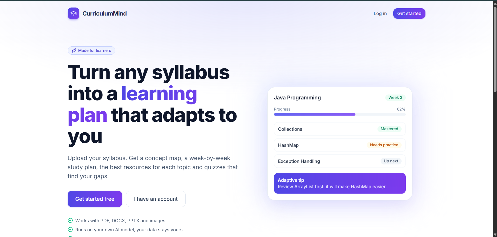 | 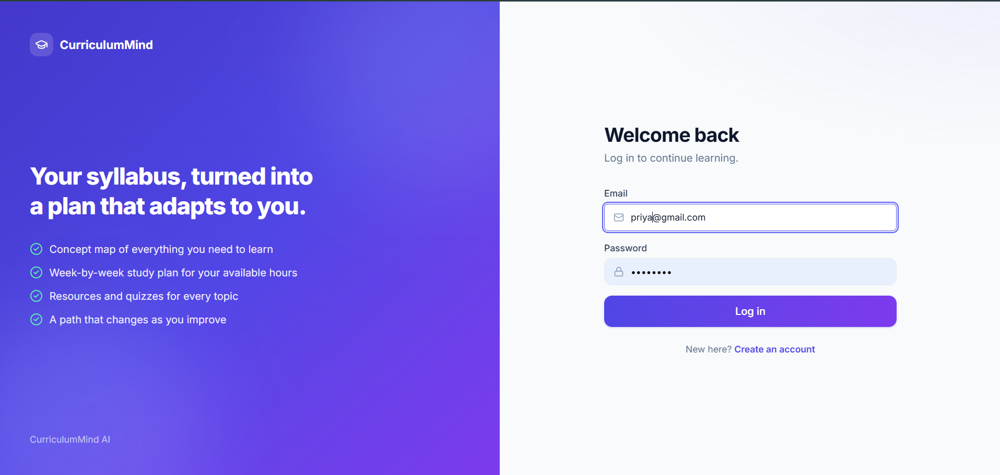 |
| **Landing page** | **Simple login/signup** |
| 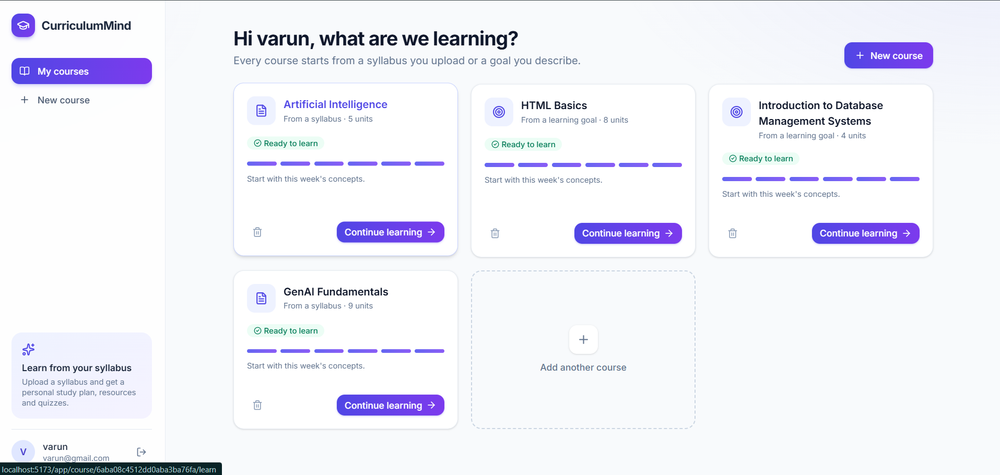 | 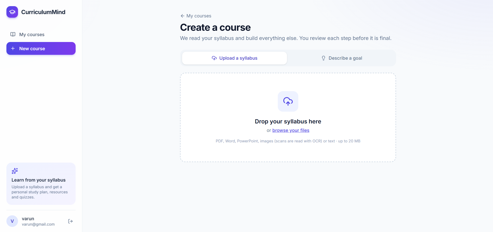 |
| **All your courses in one place** | **Upload a syllabus, or...** |
| 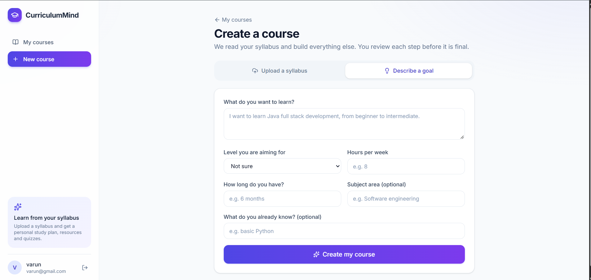 | 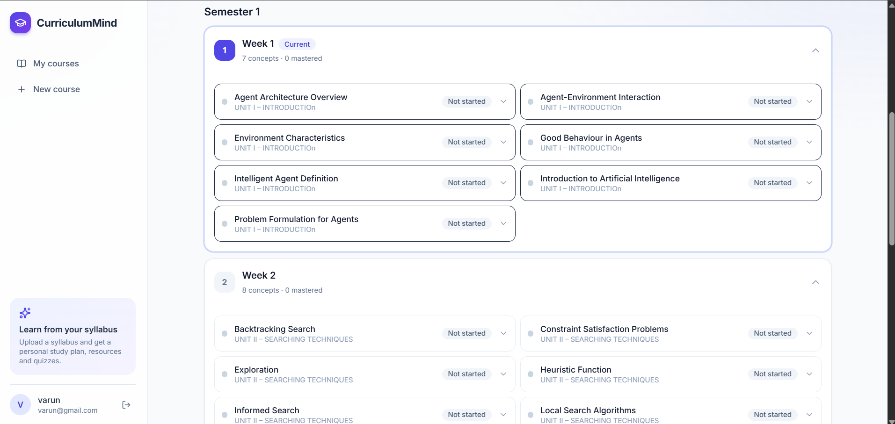 |
| **...just describe what you want to learn** | **Auto-generated week-by-week plan** |
| 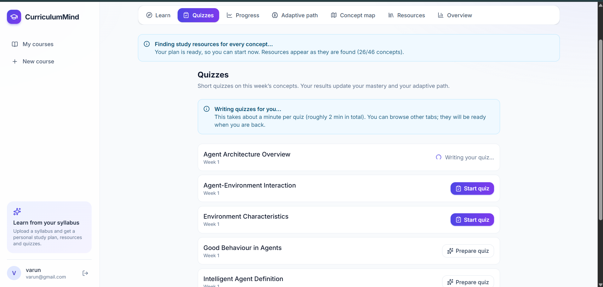 | 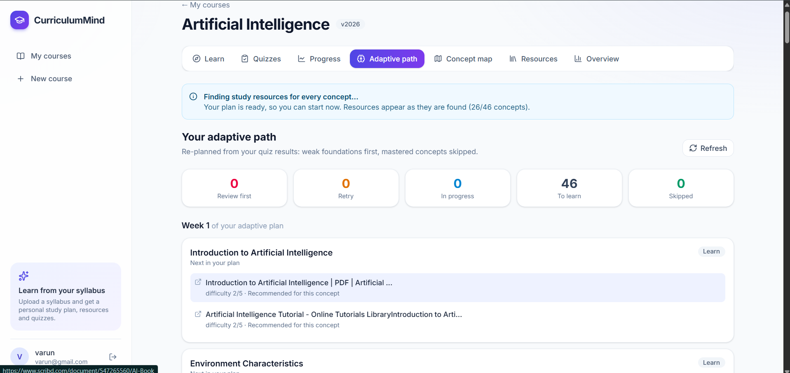 |
| **AI-generated quizzes per concept** | **Adaptive path reacts to your quiz results** |
| 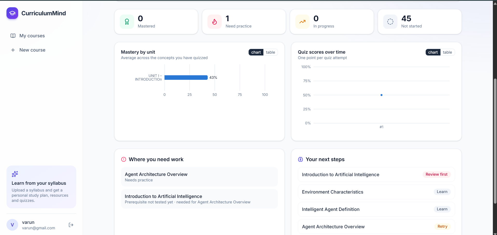 | 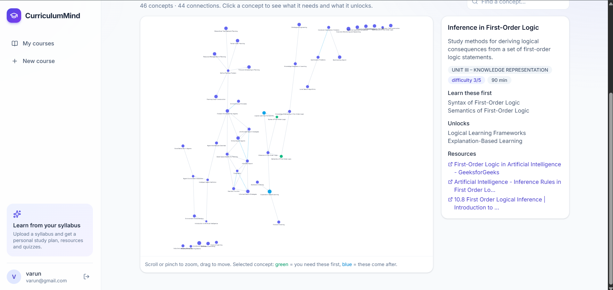 |
| **Progress & mastery dashboard** | **Interactive concept map with prerequisites** |
| 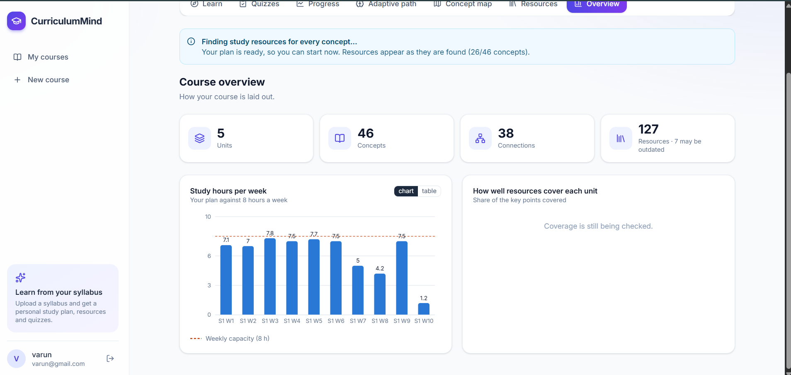 | |
| **Course overview & resource coverage** | |

---

## How it works

```
Input → Curriculum extraction → Human verification #1 → Concepts & prerequisites → Graph validation
      → Human verification #2 → Neo4j graph → Semester sequencing → Human verification #3
      → Resource discovery → Vector-search matching → Coverage & gap loop → Learning path
      → Quiz → Mastery → Knowledge gaps → Adaptive path → Quiz again …
```

## Architecture

| | MongoDB Atlas (application data) | Neo4j AuraDB (knowledge data) |
|---|---|---|
| Stores | users, password hashes, sessions, uploads, review drafts and feedback, quiz attempt history, quiz jobs | courses, units, topics, concepts, outcomes, prerequisites, resources + embeddings, coverage, semesters/weeks, learners, mastery, gaps, learning paths |
| Link | `users._id` | `(:Learner {user_id})` — the only user data Neo4j holds |

* **Backend** — Python 3.13, FastAPI, Pydantic, `pymongo` (async client), `neo4j` (async driver), NetworkX,
  Docling, sentence-transformers (`all-MiniLM-L6-v2`, 384-d, Neo4j vector indexes), Groq, trafilatura,
  youtube-transcript-api, ddgs. Long jobs run in FastAPI `BackgroundTasks` behind small job functions so they can move to
  Celery + Redis later.
* **Frontend** — React, Vite, Tailwind CSS, React Router, Axios, Cytoscape.js, Recharts.
* **AI rule** — LLM output is never trusted: Groq → structured JSON → Pydantic validation (one retry with the error
  fed back) → business validation (unknown names, duplicates, cycles, invalid quiz questions dropped) → human review where
  required → database.

## Setup

**Prerequisites:** Python 3.13, Node 20+, a free [Groq](https://console.groq.com/keys) API key,
a free MongoDB Atlas cluster, a free Neo4j AuraDB instance, and (optionally) a YouTube Data API v3 key.

```bash
# 1. configuration
cp backend/.env.example backend/.env     # then fill in every value (see the comments in the file)

# 2. backend
cd backend
python -m venv .venv
.venv\Scripts\pip install -r requirements.txt          # Windows; use .venv/bin/pip elsewhere
.venv\Scripts\python -m uvicorn app.main:app --reload --port 8000

# 3. frontend (proxies /api to :8000)
cd frontend
npm install
npm run dev                                            # http://localhost:5173
```

On first start the backend creates the MongoDB indexes and the Neo4j constraints and vector indexes. Check
`http://localhost:8000/api/health` — it should report `mongodb: ok` and `neo4j: ok`. Interactive API docs are at `/docs`.

**Environment variables** (`backend/.env`, never committed): `MONGODB_URI`, `MONGODB_DB`, `NEO4J_URI`, `NEO4J_USERNAME`,
`NEO4J_PASSWORD`, `NEO4J_TRUST_SELF_SIGNED` (dev-only TLS workaround), `GROQ_API_KEY`, `GROQ_BASE_URL`, `GROQ_MODEL`,
`YOUTUBE_API_KEY`, `JWT_SECRET` (≥ 32 random characters), `JWT_EXPIRE_MINUTES`, `CORS_ORIGINS`, `MAX_UPLOAD_MB`.

## Try it

1. Register at `/register` as **Instructor** (only instructors and admins can publish courses and see the instructor dashboard).
2. **Upload Syllabus** with [sample/java_syllabus.txt](sample/java_syllabus.txt) (also available as `.docx`, `.pdf`, `.pptx`),
   or use **Learning Goal**. Click *Extract curriculum* → review, edit or send feedback → **Approve**.
3. *Generate concepts & prerequisites* (slow on a CPU model — minutes) → review the graph, fix cycles, **Approve**.
4. **Semester plan**: choose weekly hours, drag concepts between weeks, **Approve**.
5. **Resources**: *Discover resources*, then *Analyze coverage & find gaps*.
6. **Learning Path**: *Publish* (instructor), then *Enroll*. Take quizzes; see **Dashboard** and the **Adaptive path**.

To skip the waiting, `python -m tests.e2e_pipeline` (from `backend/`) runs the whole flow against the real services and
leaves a demo account (`demo.learner@example.com` / `password123`).

## Tests

```bash
cd backend
pytest                    # 90 fast offline unit tests
pytest -m integration     # live MongoDB, Neo4j (schema + vector search), Groq, FastAPI auth/RBAC, YouTube/web search, every document format incl. OCR
pytest -m e2e             # full pipeline through the HTTP API: real databases + embeddings, stubbed LLM and web (~4 min)
python -m tests.e2e_pipeline   # same pipeline with the REAL LLM and web
```

Integration and e2e tests skip (not fail) when a service is unreachable, use throw-away accounts, and delete everything
they create. Unit tests cover password hashing, tokens, document extraction, Pydantic schemas, cycle detection,
topological sort, semester allocation, coverage, resource scoring, mastery, gap detection, quiz grading, error handling
and throttling.

## API

| Area | Endpoints |
|---|---|
| Auth | `POST /api/auth/register`, `/login`, `/logout`, `GET /api/auth/me` |
| Input | `POST /api/upload`, `GET /api/upload[/{id}]`, `POST /api/goal` |
| Curriculum | `POST /api/curriculum/extract`, `/revise`, `/verify`, `GET /api/curriculum[/{id}]` |
| Concepts & graph | `POST /api/concepts/generate`, `GET /api/concepts/{id}`, `POST /api/graph/validate`, `/verify`, `/reject`, `/revise`, `/save`, `GET /api/graph/{id}[/knowledge]` |
| Sequencing | `POST /api/sequencing/generate`, `/validate`, `/verify`, `/reject`, `GET /api/sequencing/{id}` |
| Resources | `POST /api/resources/search`, `/analyze`, `/coverage`, `/gaps/search`, `GET /api/resources/{id}` |
| Learning | `GET /api/learning-path/{user_id}`, `POST /api/learning-path/enroll`, `/publish`, `GET /api/learning-path/courses` |
| Quiz | `POST /api/quiz/generate`, `GET /api/quiz/jobs/{id}`, `GET /api/quiz/{quiz_id}`, `POST /api/quiz/submit`, `GET /api/quiz/history` |
| Learner | `GET /api/learner/{user_id}/mastery`, `/gaps`, `POST /api/adaptive-path/generate` |
| Dashboards | `GET /api/dashboard/learner/{user_id}`, `GET /api/dashboard/instructor/{curriculum_id}` |

## Security

Passwords are bcrypt-hashed; tokens are signed JWTs bound to a server-side session (logout revokes it); failed logins are
throttled (5 per 15 minutes per client and email, in-memory); uploads are checked for extension, size and file signature;
learners can only read their own data; instructor endpoints require the role; quiz answers never leave the server before
submission; secrets live only in `.env` (git-ignored) and no key is exposed to the frontend. Dependency outages return
clean 502/503 JSON, never stack traces.
**Rotate any credential that has appeared in a chat, screenshot or log.**

## Known limitations (read before relying on it)

* **Speed.** With a local 7B model on CPU, concept generation for a 6-unit course took ~16 minutes and quiz generation
  ~3 minutes per concept. Jobs run in-process (`BackgroundTasks`): a server restart loses a running job and leaves its
  status stuck at RUNNING/GENERATING (a Celery + Redis worker is the intended upgrade).
* **AI quality.** A 7B model produces sparse prerequisite graphs (25 edges for 37 concepts), sometimes generic concept
  names and optimistic study-time estimates. That is why the three human verification gates exist. Quiz questions are
  format-validated but their *correctness* is not verified — review generated quizzes before high-stakes use.
* **OCR is imperfect and needs a first-run download.** PDF (text layer), DOCX, PPTX, TXT and image OCR all work on the
  sample files, but OCR text has small errors (e.g. stray words), so the human verification step matters most for scanned
  input. RapidOCR and EasyOCR each download their models on first use; if that fails on a restricted network the upload is
  marked FAILED with a clear message instead of producing an empty curriculum. Text PDFs never need OCR.
* **Version checking is heuristic** (publication age + a small, editable table of minimum acceptable major versions in
  `resource_service.py`), not a lookup of real release data.
* **Coverage is semantic + term-based**, not a reading of the content by an expert; thresholds (`coverage_service.py`)
  are tunable. On the demo course no concept ended in `UNRESOLVED_GAP`; that path is covered by unit tests only.
* **Networks that intercept TLS** (some antivirus/proxies) break Neo4j Aura: set `NEO4J_TRUST_SELF_SIGNED=true` for local
  development only. Connection resets from Atlas/Aura are retried, but a very unreliable network will still cause errors.
* **YouTube quota** (10,000 units/day; one search costs 100) is rationed; discovery falls back to web-only when exhausted.
* Not built: password reset / e-mail verification, Celery, multi-course adaptive planning, frontend automated tests,
  dark mode, deletion of uploaded files (stored under `backend/uploads`).

## Acceptance checklist

✅ verified live / by test · ⚠ partial · ❌ not verified

| Area | Status |
|---|---|
| Register, login, logout, password hashing, MongoDB user storage | ✅ integration test |
| Role-based access | ⚠ enforced on instructor dashboard, publish, quiz regeneration; other endpoints are owner-scoped, not role-gated |
| Syllabus upload, learning-goal input, curriculum extraction, Verification #1, AI revision | ✅ |
| PDF (text layer), DOCX, PPTX, images with OCR | ✅ real sample files; ⚠ OCR output has small errors |
| Concepts, prerequisites, cycle / DAG / redundant-edge / orphan detection, Verification #2, Neo4j storage | ✅ |
| Topological sort, difficulty estimate, semester + week allocation, workload constraints, Verification #3 | ✅ |
| Outcome alignment | ⚠ implemented; the demo syllabus has no outcomes |
| Resource discovery (YouTube + web), duplicate detection, Neo4j vector search, evidence, coverage % | ✅ |
| Version checking | ⚠ heuristic |
| Gap detection, bounded 3-iteration loop, `UNRESOLVED_GAP` | ✅ unit-tested; not triggered on real data |
| Learning path, quiz generation/evaluation, quiz history in MongoDB, mastery + learner node in Neo4j | ✅ |
| Knowledge-gap detection, adaptive path, closed quiz → mastery → adaptive loop | ✅ |
| Learner and instructor dashboards, graph dashboard, semester plan, progress analytics | ✅ (viewed in a browser) |
| FastAPI, React + Vite, Tailwind, Atlas, AuraDB, Groq, sentence-transformers, Docling, NetworkX, `.env`, `.env.example` | ✅ |
| Error handling, tests, README, no secrets committed | ✅ (history checked) · Celery ❌ (ready, not built) |

## Project layout

```
backend/app/{api,services,repositories,algorithms,schemas,models,core}   FastAPI app
backend/tests/                                                            unit, integration, e2e
frontend/src/{pages,components,services,hooks,utils}                       React app
sample/                                                                    demo syllabus in txt/docx/pdf/pptx/png
```
